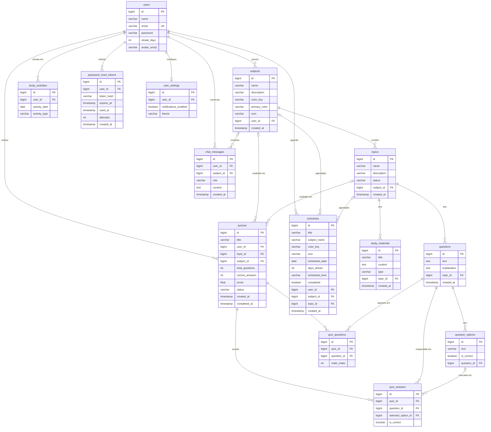

# 🗄️ TRILHA+ — Modelagem do Banco de Dados

Modelagem do banco **PostgreSQL** do Trilha+, gerada a partir das entidades JPA do back-end
(`backend/src/main/java/com/trilhamais/backend/model`). As tabelas são criadas pelo Hibernate
(`spring.jpa.hibernate.ddl-auto=update`), então este documento é a referência do que existe hoje.

> Atualizado em 23/10/2026: entraram as tabelas `study_activities`, `password_reset_tokens`,
> `user_settings` e `chat_messages`, e a agenda passou a ter `subject_id` e `topic_id` (seção 5).

---

## 1. Modelo Conceitual

| Entidade | O que representa |
|---|---|
| **Usuário** (`users`) | Estudante que usa o app. Tem login (e-mail + senha BCrypt), sequência de estudos e avatar. |
| **Matéria** (`subjects`) | Disciplina criada pelo estudante (Português, Matemática...), com cor e ícone. |
| **Assunto** (`topics`) | Tópico dentro de uma matéria, com status `pendente`, `andamento` ou `concluido`. |
| **Material de Estudo** (`study_materials`) | Resumo, anotação, texto ou artigo ligado a um assunto. |
| **Questão** (`questions`) | Pergunta de múltipla escolha de um assunto, com explicação. |
| **Alternativa** (`question_options`) | Opção de resposta de uma questão; uma delas é a correta. |
| **Simulado** (`quizzes`) | Avaliação gerada para o estudante sobre um assunto ou uma matéria. |
| **Questão do Simulado** (`quiz_questions`) | Quais questões caíram no simulado e em que ordem. |
| **Resposta** (`quiz_answers`) | Alternativa marcada pelo estudante em cada questão do simulado. |
| **Compromisso** (`schedules`) | Sessão de estudo marcada na agenda (data, horário, concluído ou não), ligada opcionalmente a uma matéria/assunto. |
| **Dia de Estudo** (`study_activities`) | Registro de que o estudante estudou num dia (base da sequência 🔥). |
| **Código de Recuperação** (`password_reset_tokens`) | Código de 6 dígitos para criar nova senha (só o hash é salvo). |
| **Configurações** (`user_settings`) | Preferências do Perfil: notificações e tema. |
| **Mensagem do Chat** (`chat_messages`) | Histórico de perguntas e respostas com o tutor de IA. |

**Relacionamentos**

- Um **usuário** tem várias **matérias**, vários **simulados** e vários **compromissos**.
- Uma **matéria** tem vários **assuntos**.
- Um **assunto** tem vários **materiais** e várias **questões**.
- Uma **questão** tem várias **alternativas**.
- Um **simulado** é de um assunto **ou** de uma matéria, tem várias **questões do simulado** e várias **respostas**.
- **Questão do simulado** e **resposta** ligam o simulado à questão (tabelas associativas N:N).
- Um **compromisso** pode apontar para uma **matéria** e/ou um **assunto**.
- Um **usuário** tem vários **dias de estudo**, **códigos de recuperação** e **mensagens do chat**, e no máximo um registro de **configurações**.
- Uma **mensagem do chat** pode estar ligada a uma **matéria** (contexto da conversa).

---

## 2. Modelo Lógico (Diagrama Entidade-Relacionamento)



**Domínios (valores permitidos)**

| Coluna | Valores |
|---|---|
| `topics.status` | `pendente` (padrão), `andamento`, `concluido` |
| `study_materials.type` | `SUMMARY`, `NOTES` (padrão), `TEXT`, `ARTICLE` |
| `quizzes.status` | `IN_PROGRESS` (padrão), `COMPLETED` |
| `study_activities.activity_type` | `QUIZ`, `TOPIC`, `SCHEDULE`, `CHAT` |
| `user_settings.theme` | `light` (padrão), `dark` |
| `chat_messages.role` | `user`, `assistant` |

**Regras de exclusão (cascata pelo JPA)**

- Apagar um **usuário** apaga as matérias dele (e, em cadeia, assuntos, materiais e questões).
- Apagar uma **matéria** apaga os assuntos; apagar um **assunto** apaga materiais e questões.
- Apagar uma **questão** apaga as alternativas; apagar um **simulado** apaga as questões sorteadas e as respostas.
- No banco (`ON DELETE`): apagar um **usuário** apaga dias de estudo, códigos, configurações e mensagens do chat; apagar uma **matéria** ou **assunto** só desliga (`SET NULL`) os compromissos e mensagens que apontavam para ela.

---

## 3. Modelo Físico (PostgreSQL)

Equivalente ao que o Hibernate gera a partir das entidades.

```sql
CREATE TABLE users (
    id            BIGSERIAL PRIMARY KEY,
    name          VARCHAR(255) NOT NULL,
    email         VARCHAR(255) NOT NULL UNIQUE,
    password      VARCHAR(255) NOT NULL,            -- hash BCrypt
    streak_days   INTEGER      NOT NULL DEFAULT 0,
    avatar_emoji  VARCHAR(20)           DEFAULT '🎓'
);

CREATE TABLE subjects (
    id             BIGSERIAL PRIMARY KEY,
    name           VARCHAR(255)  NOT NULL,
    description    VARCHAR(1000),
    color_key      VARCHAR(50),
    primary_color  VARCHAR(20),
    icon           VARCHAR(20),
    user_id        BIGINT        NOT NULL REFERENCES users(id),
    created_at     TIMESTAMP(6)  NOT NULL
);

CREATE TABLE topics (
    id           BIGSERIAL PRIMARY KEY,
    name         VARCHAR(255)  NOT NULL,
    description  VARCHAR(1000),
    status       VARCHAR(30)   NOT NULL DEFAULT 'pendente',
    subject_id   BIGINT        NOT NULL REFERENCES subjects(id),
    created_at   TIMESTAMP(6)  NOT NULL
);

CREATE TABLE study_materials (
    id          BIGSERIAL PRIMARY KEY,
    title       VARCHAR(255) NOT NULL,
    content     TEXT         NOT NULL,
    type        VARCHAR(30)  NOT NULL DEFAULT 'NOTES'
                CHECK (type IN ('SUMMARY', 'NOTES', 'TEXT', 'ARTICLE')),
    topic_id    BIGINT       NOT NULL REFERENCES topics(id),
    created_at  TIMESTAMP(6) NOT NULL
);

CREATE TABLE questions (
    id           BIGSERIAL PRIMARY KEY,
    text         TEXT         NOT NULL,
    explanation  TEXT,
    topic_id     BIGINT       NOT NULL REFERENCES topics(id),
    created_at   TIMESTAMP(6) NOT NULL
);

CREATE TABLE question_options (
    id           BIGSERIAL PRIMARY KEY,
    text         VARCHAR(255) NOT NULL,
    is_correct   BOOLEAN      NOT NULL,
    question_id  BIGINT       NOT NULL REFERENCES questions(id)
);

CREATE TABLE quizzes (
    id               BIGSERIAL PRIMARY KEY,
    title            VARCHAR(255)     NOT NULL,
    user_id          BIGINT           NOT NULL REFERENCES users(id),
    topic_id         BIGINT           REFERENCES topics(id),     -- simulado de um assunto
    subject_id       BIGINT           REFERENCES subjects(id),   -- ou de uma matéria inteira
    total_questions  INTEGER          NOT NULL,
    correct_answers  INTEGER,
    score            DOUBLE PRECISION,
    status           VARCHAR(255)     NOT NULL DEFAULT 'IN_PROGRESS'
                     CHECK (status IN ('IN_PROGRESS', 'COMPLETED')),
    created_at       TIMESTAMP(6)     NOT NULL,
    completed_at     TIMESTAMP(6)
);

CREATE TABLE quiz_questions (
    id           BIGSERIAL PRIMARY KEY,
    quiz_id      BIGINT  NOT NULL REFERENCES quizzes(id),
    question_id  BIGINT  NOT NULL REFERENCES questions(id),
    order_index  INTEGER NOT NULL
);

CREATE TABLE quiz_answers (
    id                  BIGSERIAL PRIMARY KEY,
    quiz_id             BIGINT  NOT NULL REFERENCES quizzes(id),
    question_id         BIGINT  NOT NULL REFERENCES questions(id),
    selected_option_id  BIGINT  REFERENCES question_options(id),  -- NULL = não respondeu
    is_correct          BOOLEAN NOT NULL
);

CREATE TABLE schedules (
    id              BIGSERIAL PRIMARY KEY,
    title           VARCHAR(255) NOT NULL,
    subject_name    VARCHAR(255),
    color_key       VARCHAR(50),
    icon            VARCHAR(20),
    scheduled_date  DATE,
    days_ahead      INTEGER      NOT NULL DEFAULT 0,
    scheduled_time  VARCHAR(10),                      -- ex.: '14:00'
    completed       BOOLEAN      NOT NULL DEFAULT FALSE,
    user_id         BIGINT       NOT NULL REFERENCES users(id),
    subject_id      BIGINT       REFERENCES subjects(id) ON DELETE SET NULL,
    topic_id        BIGINT       REFERENCES topics(id)   ON DELETE SET NULL,
    created_at      TIMESTAMP(6) NOT NULL
);

-- Dias de estudo (sequência 🔥 na Home, Perfil e Progresso)
CREATE TABLE study_activities (
    id             BIGSERIAL PRIMARY KEY,
    user_id        BIGINT      NOT NULL REFERENCES users(id) ON DELETE CASCADE,
    activity_date  DATE        NOT NULL,
    activity_type  VARCHAR(30) NOT NULL
                   CHECK (activity_type IN ('QUIZ', 'TOPIC', 'SCHEDULE', 'CHAT')),
    UNIQUE (user_id, activity_date, activity_type)
);

-- Recuperação de senha (tela RecuperacaoSenha)
CREATE TABLE password_reset_tokens (
    id          BIGSERIAL PRIMARY KEY,
    user_id     BIGINT       NOT NULL REFERENCES users(id) ON DELETE CASCADE,
    token_hash  VARCHAR(64)  NOT NULL,                -- SHA-256 do código de 6 dígitos
    expires_at  TIMESTAMP(6) NOT NULL,                -- 30 minutos após o pedido
    used_at     TIMESTAMP(6),
    attempts    INTEGER      NOT NULL DEFAULT 0,      -- máximo de 5 tentativas
    created_at  TIMESTAMP(6) NOT NULL
);

-- Configurações do Perfil (Notificações e Tema)
CREATE TABLE user_settings (
    id                     BIGSERIAL PRIMARY KEY,
    user_id                BIGINT      NOT NULL UNIQUE REFERENCES users(id) ON DELETE CASCADE,
    notifications_enabled  BOOLEAN     NOT NULL DEFAULT TRUE,
    theme                  VARCHAR(10) NOT NULL DEFAULT 'light'   -- light | dark
);

-- Histórico do Chat com IA
CREATE TABLE chat_messages (
    id          BIGSERIAL PRIMARY KEY,
    user_id     BIGINT       NOT NULL REFERENCES users(id) ON DELETE CASCADE,
    subject_id  BIGINT       REFERENCES subjects(id) ON DELETE SET NULL,
    role        VARCHAR(10)  NOT NULL,                 -- user | assistant
    content     TEXT         NOT NULL,
    created_at  TIMESTAMP(6) NOT NULL
);
```

---

## 4. Mapa Tela (front) ➔ Tabelas (back)

| Tela do app | Tabelas usadas | Endpoint |
|---|---|---|
| Login / Cadastro | `users` | `POST /api/auth/login`, `POST /api/users/register` |
| Recuperar senha | `users`, `password_reset_tokens` | `POST /api/auth/forgot-password`, `POST /api/auth/reset-password` |
| Home (Início) | `users`, `subjects`, `topics`, `quizzes`, `study_activities` | `GET /api/dashboard` |
| Agenda | `schedules`, `subjects`, `topics` | `GET/POST /api/schedules`, `PUT /{id}`, `PATCH /{id}/toggle`, `DELETE /{id}` |
| Matérias / Matéria | `subjects`, `topics` | `/api/subjects`, `/api/subjects/{id}/topics` |
| Assuntos | `topics`, `study_materials` | `/api/topics/{id}`, `PATCH /api/topics/{id}/status` |
| Quiz / Resultado | `quizzes`, `quiz_questions`, `quiz_answers`, `questions`, `question_options` | `/api/quizzes/generate`, `/{id}/submit`, `/{id}/result` |
| Chat com IA | `chat_messages` | `POST /api/ai/chat`, `GET/DELETE /api/ai/chat/history` |
| Progresso | `quizzes`, `quiz_answers`, `subjects`, `topics`, `study_activities` | `/api/performance/overview`, `/summary`, `/topics`, `/recommendations` |
| Perfil | `users`, `user_settings`, `study_activities` | `GET/PUT /api/users/me`, `PUT /api/users/me/password`, `GET/PUT /api/users/me/settings` |

---

## 5. Histórico de Alterações

| Data | Alteração |
|---|---|
| 23/10/2026 | Novas tabelas `study_activities`, `password_reset_tokens`, `user_settings` e `chat_messages`; colunas `subject_id` e `topic_id` em `schedules`. O Hibernate (`ddl-auto=update`) cria tudo sozinho ao subir o back-end; nenhum dado existente é apagado. |
