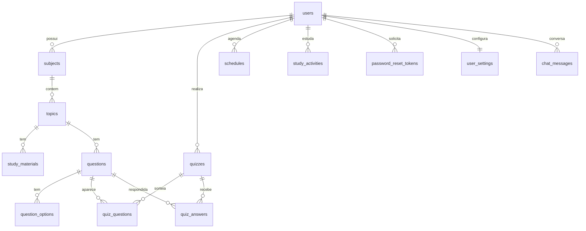

# 🎓 TRILHA+ — Plataforma Inteligente de Aprendizagem

> **Projeto Acadêmico — Análise e Desenvolvimento de Sistemas**  
> **Centro Universitário Maurício de Nassau (UNINASSAU) — Caruaru/PE**  
> **Disciplina:** Laboratório de Empreendimentos Inovadores | 4º Período  
> **Orientador:** Professor Antonio
>
> 🚀 **Ambientes em Produção (Online):**  
> 🌐 **Front-end Web (Vercel):** [https://trilha-mais.vercel.app](https://trilha-mais.vercel.app/)  
> ⚙️ **Back-end REST API (Render):** [https://trilha-mais-backend.onrender.com](https://trilha-mais-backend.onrender.com/)  
> 📖 **Swagger UI Interativo:** [https://trilha-mais-backend.onrender.com/swagger-ui/index.html](https://trilha-mais-backend.onrender.com/swagger-ui/index.html)  

O **TRILHA+** é uma solução educacional móvel desenvolvida como projeto acadêmico interdisciplinar para auxiliar estudantes universitários no planejamento, organização e acompanhamento contínuo da sua rotina de estudos. A plataforma centraliza em uma única experiência intuitiva: **gestão de matérias e assuntos com indicadores visuais, cronograma de estudos com agenda integrada, dashboard consolidado de desempenho, tutoria inteligente com IA Generativa multi-turn (Groq Cloud / Llama 3.3 70B), simulados avaliativos dinâmicos com proteção anti-fraude e diagnóstico detalhado de pontos fortes e fracos**.

O projeto aplica na prática conceitos avançados de **Engenharia de Software, Arquitetura de Software em Camadas, Desenvolvimento Mobile com React Native e Expo, Segurança e Autenticação JWT Stateless, Inteligência Artificial Aplicada, Modelagem de Bancos de Dados Relacionais em PostgreSQL e Testes Automatizados**.

---

## 👥 Equipe do Projeto

| Integrante | Matrícula | Responsabilidade no Projeto |
| :--- | :---: | :--- |
| **Pedro Francisco Alves Neto** | **01864946** | **Arquitetura, Desenvolvimento e Testes do Back-end** |
| **Allan Victor Morais De Lima** | **01813117** | **Desenvolvimento do Back-end e Integrações** |
| **Gabriel Henrique da Silva** | **01777141** | **Desenvolvimento Front-end / Mobile (React Native)** |
| **Vinicius Santos Cansanção** | **01813852** | **Desenvolvimento Front-end / Mobile (React Native)** |
| **Luiz Henrique Manoel da Silva** | **01777463** | **Documentação Técnica e Gestão do Projeto** |

---

## 🎯 Objetivo e Proposta de Valor

O objetivo central do **TRILHA+** é combater a procrastinação, a desorganização e a sobrecarga de conteúdos vivenciadas por estudantes universitários e concurseiros, estruturando os estudos em torno da **Jornada Contínua de Aprendizagem**:

```text
┌──────────────┐     ┌──────────────┐     ┌──────────────┐     ┌──────────────┐     ┌──────────────┐
│  Onde estou  │ ──> │ O que estudar│ ──> │ Como estudar │ ──> │ Como estou   │ ──> │ O que devo   │
│ (Dashboard)  │     │  (Matérias)  │     │(Resumos/IA)  │     │  evoluindo   │     │   melhorar   │
│  & Agenda    │     │  & Assuntos  │     │ & Chat Tutor │     │ (Simulados)  │     │ (Diagnóstico)│
└──────────────┘     └──────────────┘     └──────────────┘     └──────────────┘     └──────────────┘
```

A plataforma personaliza a trajetória do estudante, identificando assuntos críticos através de simulados e recomendando automaticamente revisões direcionadas.

---

## 🏗️ Arquitetura do Sistema

A aplicação é dividida em dois ecossistemas independentes e desacoplados, comunicando-se por meio de uma API RESTful padronizada em JSON:

```text
┌────────────────────────────────────────────────────────┐
│               FRONT-END MOBILE (Cliente)               │
│          React Native + Expo + TypeScript              │
│       React Navigation (Native Stack) + Telas          │
└───────────────────────────┬────────────────────────────┘
                            │
                            │ Requisições HTTP REST / JSON
                            │ Cabeçalho Bearer JWT (CORS Habilitado)
                            ▼
┌────────────────────────────────────────────────────────┐
│                BACK-END API (Servidor)                 │
│              Java 21 LTS + Spring Boot 4               │
│  Controladores ➔ Serviços ➔ Repositórios ➔ Entidades   │
│         Spring Security + JWT + BCrypt + Swagger       │
└───────────────┬────────────────────────┬───────────────┘
                │                        │
                ▼                        ▼
┌──────────────────────────────┐   ┌──────────────────────────────┐
│       Banco de Dados         │   │   Inteligência Artificial    │
│        PostgreSQL            │   │       Groq Cloud API         │
│  JPA / Hibernate Relacional  │   │   Llama 3.3 70B Versatile    │
└──────────────────────────────┘   └──────────────────────────────┘
```

---

## 📱 Front-end Mobile (React Native & Expo)

O aplicativo móvel foi desenvolvido em React Native com TypeScript e Expo, proporcionando interface moderna, tipagem estrita e navegação nativa e intuitiva.

### Tecnologias Utilizadas:
- **Framework:** React Native com **Expo** (`~57.0.22`)
- **Linguagem:** TypeScript (compilação estrita com `npx tsc --noEmit` sem erros)
- **Navegação:** `@react-navigation/native` e `@react-navigation/native-stack`
- **Componentes & Telas:** `react-native-safe-area-context` e `react-native-screens`
- **Estilização:** StyleSheet nativo e temas centralizados (`tokens.css`, `screenTheme.ts`)
- **Variáveis de Ambiente:** Suporte a `.env` com template `frontend/.env.example`

### Módulos e Telas:

> ⚠️ As telas ainda usam dados de exemplo (mocks em `src/Mocks`). A ligação com a API do back-end está em andamento — veja [Status da Integração](#-status-da-integração-e-pendências).

1. **Autenticação:** Telas de `Login`, `Cadastro` e `RecuperacaoSenha`.
2. **Dashboard / Home (`Home.tsx`):**
   - Ofensiva de estudos em dias (`streakDays`), card "Continuar de onde parou".
   - Carrossel de matérias com cores, ícones e progresso calculado em tempo real.
   - Barra de navegação inferior permanente para alternância ágil de telas.
3. **Cronograma e Estudos (`Agenda.tsx`):**
   - Listagem de compromissos categorizados por dia e horário.
   - Suporte a marcação rápida de tarefas concluídas (toggle) e agendamento de novas sessões.
4. **Matérias & Assuntos (`Materias.tsx`, `Materia.tsx`, `Assuntos.tsx`):**
   - Visualização por matéria com tokens visuais (`colorKey`, `primaryColor`, `icon`).
   - Lista de assuntos com badges de status (`pendente`, `andamento`, `concluido`) e atualização com um toque.
   - Botão direto para iniciar sessão de tutoria com IA sobre a matéria/assunto atual.
5. **Tutor Inteligente de IA (`ChatIAScreen.tsx`):**
   - Chat interativo com suporte a conversas continuadas (multi-turn).
   - Contexto acadêmico pré-carregado a partir da matéria selecionada.
6. **Simulados e Avaliação (`TelaQuiz.tsx` e `TelaResultado.tsx`):**
   - Resolução de prova sem exposição prévia de gabaritos.
   - Tela de resultado com nota, percentual de aproveitamento e diagnóstico automático de **pontos fortes** e **pontos fracos a revisar**.
7. **Perfil do Aluno (`Perfil.tsx`):**
   - Estatísticas de precisão geral (`overallAccuracy`), total de questões respondidas e dias em sequência.

---

## ⚙️ Back-end RESTful API (Java 21 & Spring Boot 4)

O back-end foi construído com arquitetura robusta, segura e orientada a serviços corporativos.

### Tecnologias e Bibliotecas:
- **Linguagem:** Java 21 LTS
- **Framework:** Spring Boot 4 (`spring-boot-starter-webmvc`, `spring-boot-starter-data-jpa`, `spring-boot-starter-security`, `spring-boot-starter-validation`)
- **Segurança:** Spring Security com criptografia **BCrypt** e tokens **JWT (io.jsonwebtoken / HMAC-SHA256)** com expiração de 24h
- **Banco de Dados:** **PostgreSQL** com Hibernate ORM (`PostgreSQLDialect` e mapeamento `TEXT`)
- **Inteligência Artificial:** **Groq Cloud API** com modelo **Llama 3.3 70B Versatile**
- **Documentação Interativa:** Springdoc OpenAPI 3.0 e Swagger UI
- **Comunicação Cross-Origin:** Configuração global de **CORS** para integração fluida com emuladores e dispositivos mobile
- **Qualidade de Software:** Testes automatizados unitários e de integração com JUnit 5 e MockMvc

### Principais Módulos do Back-end:
1. **🔐 Autenticação & Gestão de Usuários (`/api/auth`, `/api/users`)**:
   - Registro de estudantes com validações e proteção contra e-mails duplicados.
   - Login seguro com geração de token JWT Bearer.
   - Perfil do estudante (`/api/users/me`) com dados consolidados (`streakDays`, `avatarEmoji`, `overallAccuracy`, `totalQuestionsAnswered`, `totalQuizzesCompleted`).
2. **🏠 Dashboard Unificado (`/api/dashboard`)**:
   - Endpoint consolidado (`GET /api/dashboard`) que entrega em uma única requisição todos os indicadores da Home (ofensiva, progresso global, próximo tópico a estudar e resumo de matérias com cores e progresso).
3. **📅 Agenda & Cronograma (`/api/schedules`)**:
   - Gestão completa de tarefas de estudo (`GET`, `POST`, `DELETE`).
   - Endpoint rápido `PATCH /api/schedules/{id}/toggle` para marcar compromissos como concluídos.
4. **📚 Gestão Acadêmica Multitenancy (`/api/subjects`, `/api/topics`, `/api/materials`)**:
   - Hierarquia: Matérias ➔ Assuntos/Tópicos ➔ Materiais didáticos.
   - Atributos visuais em Matérias (`colorKey`, `primaryColor`, `icon`) e contagem dinâmica de progresso (`completedCount`, `inProgressCount`, `totalTopics`, `progressPercentage`).
   - Endpoint rápido `PATCH /api/topics/{id}/status?status=concluido` para atualização instantânea pelo mobile.
5. **🤖 Tutor Educacional com IA Generativa (`/api/ai`)**:
   - Chat multi-turn conversacional (`POST /api/ai/chat`) com retenção de histórico (`messages: [{role, content}]`).
   - Tira-dúvidas pontual (`POST /api/ai/ask`) e resumos automáticos (`POST /api/ai/summarize`).
   - Mecanismo de fallback pedagógico resiliente contra indisponibilidades da rede externa.
6. **📝 Simulados Dinâmicos Anti-Fraude & Diagnóstico (`/api/quizzes`, `/api/questions`)**:
   - Banco de questões de múltipla escolha com gabarito único.
   - Geração dinâmica de simulados de **10 ou 15 questões** por matéria ou assunto.
   - **Mecanismo Anti-Fraude:** ocultação absoluta de gabaritos durante a prova (`IN_PROGRESS`).
   - Correção instantânea pós-envio (`COMPLETED`) com nota (0.0 a 10.0), gabarito comentado e listas de **pontos fortes** e **pontos fracos** geradas dinamicamente.
7. **📊 Diagnóstico de Desempenho e Recomendações (`/api/performance`)**:
   - Taxas de acerto gerais e por disciplina (`CRITICAL`, `REGULAR`, `MASTERED`).
   - Recomendações didáticas da IA com roteiro personalizado de estudos.

---

## 🗄️ Modelagem do Banco de Dados

A modelagem completa (conceitual, lógica com diagrama ER e física em SQL) está em **[`MODELAGEM.md`](./MODELAGEM.md)**.

Resumo das tabelas (PostgreSQL, geradas pelo Hibernate):

| Tabela | Descrição | Ligações |
| :--- | :--- | :--- |
| `users` | Estudantes (e-mail único, senha BCrypt, sequência, avatar) | — |
| `subjects` | Matérias com cor e ícone | `user_id` |
| `topics` | Assuntos (`pendente`, `andamento`, `concluido`) | `subject_id` |
| `study_materials` | Resumos, anotações, textos e artigos | `topic_id` |
| `questions` / `question_options` | Banco de questões e alternativas | `topic_id` / `question_id` |
| `quizzes` | Simulados (`IN_PROGRESS` / `COMPLETED`) | `user_id`, `topic_id` ou `subject_id` |
| `quiz_questions` / `quiz_answers` | Questões sorteadas e respostas marcadas | `quiz_id`, `question_id` |
| `schedules` | Compromissos da agenda | `user_id`, `subject_id`, `topic_id` |
| `study_activities` | Dias em que o estudante estudou (base da sequência 🔥) | `user_id` |
| `password_reset_tokens` | Códigos de recuperação de senha (só o hash) | `user_id` |
| `user_settings` | Notificações e tema do Perfil | `user_id` |
| `chat_messages` | Histórico do chat com a IA | `user_id`, `subject_id` |



---

## 🚧 Status da Integração e Pendências

Comparação entre as telas do front-end e o que a API entrega (atualizado em 23/10/2026).

**Back-end: tudo que as telas pedem já existe na API.** Itens adicionados em 23/10/2026:

| Tela | O que foi feito no back-end |
| :--- | :--- |
| Recuperar senha | `POST /api/auth/forgot-password` envia código de 6 dígitos (vale 30 min, até 5 tentativas, só o hash fica no banco) e `POST /api/auth/reset-password` troca a senha. Sem servidor de e-mail configurado, o código aparece no log do back-end. |
| Home / Perfil / Progresso (🔥) | A sequência de dias agora é calculada de verdade (tabela `study_activities`). Conta quando o estudante finaliza um simulado, começa/conclui um assunto, conclui um compromisso da agenda ou usa o chat. |
| Progresso | `GET /api/performance/overview`: média geral, avaliações, assuntos estudados, sequência, aproveitamento por matéria, melhor matéria e "precisa revisar". |
| Perfil | Editar nome/avatar (`PUT /api/users/me`), trocar senha (`PUT /api/users/me/password`) e Notificações/Tema (`/api/users/me/settings`). |
| Agenda | Editar compromisso (`PUT /api/schedules/{id}`), ligação com matéria/assunto (`subjectId`, `topicId`) e data real gravada: "Hoje"/"Amanhã" (`daysAhead`) é recalculado a cada dia. Corrigido erro 400 quando o app não enviava `daysAhead`. |
| Chat com IA | Histórico salvo (`GET`/`DELETE /api/ai/chat/history`), com `subjectId` opcional no `POST /api/ai/chat`. |
| Home | O card "Continuar de onde parou" agora traz `continueSubjectId` e `continueTopicId`. |
| Assuntos | `PATCH /api/topics/{id}/status` recusa status fora de `pendente`, `andamento` e `concluido`. |

**Falta no front-end (para usar a API):**

- Criar o serviço de chamadas à API (`src/services/api.ts`) usando `EXPO_PUBLIC_API_URL` e guardar o token JWT após o login.
- Trocar os mocks das telas pelos endpoints da tabela abaixo.
- O chat chama a Groq direto do app, com a chave no front. O certo é usar `POST /api/ai/chat`, para a chave ficar só no servidor.
- O quiz usa questões fixas na tela; deve usar `POST /api/quizzes/generate` com o `topicId` e a quantidade escolhida (10 ou 15).
- A tela de recuperar senha precisa de um campo para o código de 6 dígitos e a nova senha.

A modelagem de todas as tabelas está no [`MODELAGEM.md`](./MODELAGEM.md).

---

## 📋 Catálogo Completo de Endpoints REST

| Módulo | Método | Endpoint | Protegido? | Descrição |
| :--- | :---: | :--- | :---: | :--- |
| **Dashboard** | `GET` | `/api/dashboard` | Sim | Resumo consolidado para a tela inicial (ofensiva, matérias, progresso) |
| **Agenda** | `GET` | `/api/schedules` | Sim | Lista compromissos de estudo ordenados cronologicamente |
| | `POST` | `/api/schedules` | Sim | Cria compromisso (pode ligar a `subjectId`/`topicId` e definir `scheduledDate`) |
| | `PUT` | `/api/schedules/{id}` | Sim | Edita compromisso (título, data, horário, matéria/assunto) |
| | `PATCH`| `/api/schedules/{id}/toggle` | Sim | Alterna status de conclusão do compromisso |
| | `DELETE`| `/api/schedules/{id}` | Sim | Remove compromisso de estudo |
| **Autenticação** | `POST` | `/api/users/register` | Não | Cadastra um novo estudante |
| | `POST` | `/api/auth/login` | Não | Autentica e gera token JWT Bearer |
| | `POST` | `/api/auth/forgot-password` | Não | Envia código de 6 dígitos por e-mail para recuperar a senha |
| | `POST` | `/api/auth/reset-password` | Não | Troca a senha usando o código recebido |
| | `GET` | `/api/users/profile` | Sim | Consulta perfil autenticado |
| | `GET` | `/api/users/me` | Sim | Perfil completo com métricas de desempenho |
| | `PUT` | `/api/users/me` | Sim | Edita nome e avatar |
| | `PUT` | `/api/users/me/password` | Sim | Troca a senha (exige a senha atual) |
| | `GET` | `/api/users/me/settings` | Sim | Configurações (notificações e tema) |
| | `PUT` | `/api/users/me/settings` | Sim | Atualiza notificações e tema (`light`/`dark`) |
| **Matérias** | `GET` | `/api/subjects` | Sim | Lista matérias com cores, ícones e contadores de progresso |
| | `POST` | `/api/subjects` | Sim | Cadastra nova matéria (suporta colorKey, primaryColor, icon) |
| | `GET` | `/api/subjects/{id}` | Sim | Detalhes da matéria e lista de seus tópicos |
| | `PUT` | `/api/subjects/{id}` | Sim | Atualiza dados da matéria |
| | `DELETE`| `/api/subjects/{id}` | Sim | Exclui matéria e seus assuntos |
| **Assuntos** | `GET` | `/api/subjects/{subjectId}/topics` | Sim | Lista tópicos vinculados à matéria |
| | `POST` | `/api/subjects/{subjectId}/topics` | Sim | Cria tópico na matéria com status inicial |
| | `GET` | `/api/topics/{id}` | Sim | Detalhes do tópico |
| | `PUT` | `/api/topics/{id}` | Sim | Atualiza título/descrição do tópico |
| | `PATCH`| `/api/topics/{id}/status?status=...` | Sim | Atualiza status (`pendente`, `andamento`, `concluido`) |
| | `DELETE`| `/api/topics/{id}` | Sim | Remove o tópico |
| **Materiais** | `GET` | `/api/topics/{topicId}/materials` | Sim | Lista materiais didáticos do tópico |
| | `POST` | `/api/topics/{topicId}/materials` | Sim | Adiciona material didático de apoio |
| | `GET` | `/api/materials/{id}` | Sim | Consulta material por ID |
| | `PUT` | `/api/materials/{id}` | Sim | Atualiza material didático |
| | `DELETE`| `/api/materials/{id}` | Sim | Remove material |
| **Questões** | `POST` | `/api/topics/{topicId}/questions` | Sim | Cadastra questão com alternativas |
| | `GET` | `/api/topics/{topicId}/questions` | Sim | Lista questões do tópico |
| | `GET` | `/api/questions/{id}` | Sim | Detalhes da questão com gabarito |
| | `DELETE`| `/api/questions/{id}` | Sim | Remove questão |
| **Simulados** | `POST` | `/api/quizzes/generate` | Sim | Gera simulado com gabarito oculto |
| | `GET` | `/api/quizzes/{id}` | Sim | Caderno de prova para resolução |
| | `POST` | `/api/quizzes/{id}/submit` | Sim | Envia respostas, fecha prova e retorna nota, gabarito, fortes e fracos |
| | `GET` | `/api/quizzes/{id}/result` | Sim | Resultado detalhado com diagnóstico |
| | `GET` | `/api/quizzes` | Sim | Histórico de simulados do estudante |
| **Tutor IA** | `POST` | `/api/ai/chat` | Sim | **Chat conversacional multi-turn** com retenção de histórico |
| | `POST` | `/api/ai/ask` | Sim | Tira dúvidas pontuais sobre o tópico |
| | `POST` | `/api/ai/summarize` | Sim | Gera resumo didático e tópicos-chave |
| | `GET` | `/api/ai/chat/history?subjectId=` | Sim | Histórico salvo do chat (opcionalmente por matéria) |
| | `DELETE`| `/api/ai/chat/history?subjectId=` | Sim | Apaga o histórico do chat |
| **Performance**| `GET` | `/api/performance/summary` | Sim | Resumo consolidado de acertos e notas |
| | `GET` | `/api/performance/topics` | Sim | Diagnóstico de domínio por assunto |
| | `GET` | `/api/performance/overview` | Sim | Tela Progresso: média geral, por matéria, melhor matéria e "precisa revisar" |
| | `GET` | `/api/performance/recommendations` | Sim | Recomendações e plano de estudo gerado pela IA |

---

## 📂 Estrutura de Pastas do Repositório

```text
trilha-mais/
├── backend/                              # Servidor API REST (Java 21 / Spring Boot 4 / PostgreSQL)
│   ├── src/main/java/com/trilhamais/backend/
│   │   ├── config/                       # Segurança, CORS, JWT e OpenAPI
│   │   ├── controller/                   # 11 Controladores REST (Dashboard, Schedule, Ai, etc.)
│   │   ├── dto/                          # Objetos de Transferência de Dados (Requests/Responses)
│   │   ├── model/                        # 14 Entidades JPA + 3 enums (PostgreSQL)
│   │   ├── exception/                    # Tratamento Global de Exceções RFC 7807
│   │   ├── repository/                   # Interfaces Spring Data JPA
│   │   └── service/                      # Serviços de Regra de Negócio e IA Groq
│   ├── src/main/resources/
│   │   └── application.properties        # Configurações do PostgreSQL, JWT e Groq
│   ├── src/test/java/                    # Testes Automatizados (API, E2E e banco de dados)
│   ├── database/                         # Scripts SQL (schema.sql e dados-exemplo.sql)
│   ├── pom.xml                           # Dependências Maven (Spring Boot 4, PostgreSQL, JJWT)
│   └── mvnw                              # Maven Wrapper executável
│
├── frontend/                             # Aplicativo Mobile (React Native / Expo / TypeScript)
│   ├── assets/                           # Ícones, splash screen e imagens
│   ├── src/
│   │   ├── components/                   # Componentes reutilizáveis (BarraNavegacao, etc.)
│   │   ├── Navigation/                   # Rotas unificadas do app (AppRoutes.tsx)
│   │   ├── pages/                        # Telas (Home, Agenda, Materia, Assuntos, ChatIA, Quiz, Perfil)
│   │   ├── services/                     # Serviços de integração (groq, api)
│   │   └── theme/                        # Paleta de cores, tipografia e espaçamentos
│   ├── .env.example                      # Template de variáveis de ambiente do mobile
│   ├── App.tsx                           # Ponto de entrada do aplicativo
│   ├── app.json                          # Configurações do Expo
│   ├── package.json                      # Dependências Node / Expo (com script build expo web)
│   ├── vercel.json                       # Configuração de rewrites SPA para Vercel
│   └── tsconfig.json                     # Configuração estrita do TypeScript
│
├── vercel.json                           # Configuração raiz da Vercel para monorepo
├── package.json                          # Scripts de orquestração raiz (npm run build)
├── TrilhaMais_API_Postman_Collection.json # Coleção oficial do Postman com todos os endpoints
├── MODELAGEM.md                          # Modelagem do banco (conceitual, lógico e físico)
├── .gitignore                            # Arquivos e credenciais ignorados pelo Git
└── README.md                             # Documentação principal do projeto
```

---

## ⚡ Como Executar o Projeto Localmente

### 1. Inicializando o Back-end (API REST)

#### Pré-requisitos:
- **Java 21 (LTS)** instalado (`java -version`)
- **PostgreSQL** instalado e em execução (porta padrão `5432`)
- Criar os bancos de dados no PostgreSQL (o segundo é só para os testes automatizados):
  ```sql
  CREATE DATABASE trilha_mais;
  CREATE DATABASE trilha_mais_test;
  ```

#### Passos:
```bash
# 1. Acesse o diretório do backend
cd backend

# 2. Inicie a aplicação com o Maven Wrapper
./mvnw spring-boot:run
```
O servidor inicializará automaticamente as tabelas e estará acessível em: **`http://localhost:8080`**.

> A senha do PostgreSQL de cada máquina vai no arquivo `backend/src/main/resources/application-local.properties`
> (`spring.datasource.password=...`), que é ignorado pelo Git.

#### Scripts SQL do banco (`backend/database/`):
| Arquivo | Para que serve |
| :--- | :--- |
| [`schema.sql`](./backend/database/schema.sql) | Cria todas as 14 tabelas, chaves e restrições (o mesmo que o Hibernate gera). Use se quiser montar o banco sem subir o back-end. |
| [`dados-exemplo.sql`](./backend/database/dados-exemplo.sql) | Cadastra um estudante de demonstração com as matérias, assuntos e agenda das telas do app. Login: `demo@trilhamais.app` / senha `123456`. |

```bash
psql -U postgres -d trilha_mais -f backend/database/schema.sql         # opcional: o back-end já cria as tabelas
psql -U postgres -d trilha_mais -f backend/database/dados-exemplo.sql  # dados para demonstração
```

#### Executando a Suíte de Testes Automatizados:
```bash
cd backend
./mvnw test
```
Os testes usam o banco **`trilha_mais_test`** (configurado no `pom.xml`), separado do banco do app: rodar os testes **não apaga** os dados do `trilha_mais`. O `DatabaseSchemaTest` testa o próprio banco: existência das 14 tabelas, `UNIQUE`, `FOREIGN KEY`, `CHECK` e `ON DELETE`.

---

### 2. Inicializando o Front-end Mobile (React Native / Expo)

#### Pré-requisitos:
- **Node.js** (versão 18 ou superior) instalado
- Dispositivo Android/iOS com o aplicativo **Expo Go** instalado (ou emulador/navegador)

#### Passos:
```bash
# 1. Acesse o diretório do frontend
cd frontend

# 2. Instale as dependências
npm install

# 3. Configure as variáveis de ambiente (se necessário)
cp .env.example .env

# 4. Inicie o servidor de desenvolvimento do Expo
npx expo start
```

Após iniciar:
- Pressione **`a`** para abrir no emulador Android.
- Pressione **`i`** para abrir no simulador iOS.
- Pressione **`w`** para abrir no navegador Web.
- Ou escaneie o **QR Code** no terminal usando o aplicativo **Expo Go** no smartphone.

---

## 🚀 Acessos Online

- 🌐 **Front-end:** [https://trilha-mais.vercel.app](https://trilha-mais.vercel.app/)
- ⚙️ **Back-end:** [https://trilha-mais-backend.onrender.com](https://trilha-mais-backend.onrender.com/)

---

## 🌐 Testes e Documentação das APIs REST

### 1. Swagger UI Interativo (Via Navegador)
Com o back-end em execução, acesse:  
👉 **`http://localhost:8080/swagger-ui.html`**  
*(Ou a especificação bruta OpenAPI JSON em `http://localhost:8080/v3/api-docs`)*

- Para testar rotas protegidas, clique no botão **`Authorize 🔒`** no canto superior direito e insira o token obtido no login no formato: `Bearer seu_token_jwt`.

---

### 2. Coleção do Postman (Guia Oficial)

O repositório inclui a coleção oficial completa e atualizada: [`TrilhaMais_API_Postman_Collection.json`](./TrilhaMais_API_Postman_Collection.json).

#### 📥 Como Importar no Postman:
1. Abra o **Postman** (Desktop ou Web).
2. Clique no botão **"Import"** no canto superior esquerdo (ou `Ctrl + O` / `Cmd + O`).
3. Selecione ou arraste o arquivo **`TrilhaMais_API_Postman_Collection.json`** da raiz do projeto.
4. A coleção **"Trilha+ API — Coleção Postman Oficial (UNINASSAU)"** será carregada com todas as pastas organizadas.

#### ⚙️ Gerenciamento Automático de Tokens:
- A requisição **"Login (Obter Token JWT)"** possui script pós-execução que armazena automaticamente o token retornado na variável `{{token}}`.
- Todas as demais requisições autenticadas já herdam automaticamente o cabeçalho `Authorization: Bearer {{token}}`. Não é necessário copiar e colar tokens manualmente!

---

## ⚠️ Nota Acadêmica

Este projeto é desenvolvido com finalidade estritamente educacional para a conclusão de disciplinas práticas no curso de **Análise e Desenvolvimento de Sistemas** da **UNINASSAU — Caruaru**.

---

*UNINASSAU Caruaru — Análise e Desenvolvimento de Sistemas | 2026*
